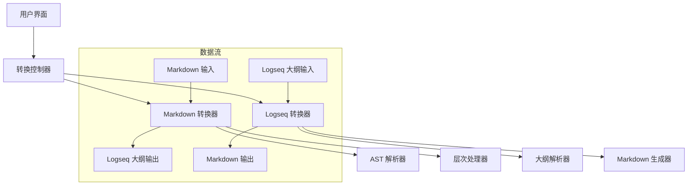

# 设计文档

## 概述

本设计文档描述了对现有 Markdown 到大纲转换器的改进，主要包括：
1. 修复层次缩进问题，确保嵌套内容正确缩进
2. 移除 Logseq TODO 转换选项，使其成为默认行为
3. 实现双向转换功能，支持 Markdown ↔ Logseq 大纲格式互转
4. 重新设计 UI 为左右分栏布局

## 架构

### 整体架构图



### 核心组件架构

- **双向转换引擎**: 管理 Markdown ↔ Logseq 大纲的转换逻辑
- **层次处理器**: 确保正确的缩进和层次结构
- **UI 控制器**: 管理左右分栏的同步和用户交互
- **错误处理器**: 提供友好的错误提示和恢复机制

## 组件和接口

### 1. 核心 Hook: `useBidirectionalConverter`

```typescript
interface BidirectionalConverterOptions {
  removeHeaderMarkers: boolean;
}

interface BidirectionalConverterResult {
  markdownContent: string;
  logseqContent: string;
  error: string | null;
  updateMarkdown: (content: string) => void;
  updateLogseq: (content: string) => void;
  clearAll: () => void;
}

export function useBidirectionalConverter(
  options: BidirectionalConverterOptions
): BidirectionalConverterResult
```

### 2. 转换工具函数

```typescript
// 改进的 Markdown 到 Logseq 转换
export function convertMarkdownToLogseq(
  markdown: string, 
  options: ConvertToLogseqOptions
): string

// 新增的 Logseq 到 Markdown 转换
export function convertLogseqToMarkdown(
  logseqContent: string,
  options: ConvertToMarkdownOptions
): string

// 层次结构处理器
export function processHierarchy(
  nodes: MarkdownNode[],
  depth: number
): string
```

### 3. UI 组件

```typescript
// 主页面组件
export default function Home(): JSX.Element

// 分栏编辑器组件
interface PanelEditorProps {
  title: string;
  content: string;
  placeholder: string;
  onChange: (content: string) => void;
  error?: string | null;
}

export function PanelEditor(props: PanelEditorProps): JSX.Element
```

## 数据模型

### 转换选项

```typescript
interface ConvertToLogseqOptions {
  removeHeaderMarkers: boolean;
  enableTodoConversion: boolean; // 始终为 true
}

interface ConvertToMarkdownOptions {
  preserveIndentation: boolean;
  convertTodoItems: boolean;
}
```

### 层次节点结构

```typescript
interface HierarchyNode {
  type: 'heading' | 'paragraph' | 'list' | 'listItem' | 'code' | 'blockquote';
  level: number;
  content: string;
  children: HierarchyNode[];
  parent?: HierarchyNode;
}
```

### Logseq 大纲节点

```typescript
interface LogseqNode {
  type: 'bullet' | 'todo' | 'done' | 'heading';
  level: number;
  content: string;
  indentation: number;
  children: LogseqNode[];
}
```

## 错误处理

### 错误类型定义

```typescript
enum ConversionErrorType {
  PARSE_ERROR = 'parse_error',
  FORMAT_ERROR = 'format_error',
  HIERARCHY_ERROR = 'hierarchy_error',
  UNKNOWN_ERROR = 'unknown_error'
}

interface ConversionError {
  type: ConversionErrorType;
  message: string;
  line?: number;
  suggestion?: string;
}
```

### 错误处理策略

1. **解析错误**: 当输入格式无法识别时，显示具体的错误位置和建议
2. **格式错误**: 当转换过程中遇到不支持的格式时，提供替代方案
3. **层次错误**: 当层次结构不正确时，自动修复或提示用户
4. **优雅降级**: 部分转换失败时，显示成功转换的部分并标记错误区域

## 测试策略

### 单元测试

1. **转换函数测试**
   - Markdown 到 Logseq 转换的各种场景
   - Logseq 到 Markdown 转换的各种场景
   - 层次结构处理的正确性
   - 边界情况和错误处理

2. **Hook 测试**
   - 双向转换 Hook 的状态管理
   - 用户输入的响应性
   - 错误状态的处理

### 集成测试

1. **UI 交互测试**
   - 左右分栏的同步更新
   - 用户输入的实时转换
   - 复制功能的正确性

2. **端到端测试**
   - 完整的转换流程
   - 复杂文档的处理
   - 性能测试

### 测试用例示例

```typescript
describe('层次结构转换', () => {
  test('应该正确处理嵌套标题', () => {
    const markdown = `## 我擅长的技能
### 写作
我热爱文字创作，具备不错的写作与书面表达能力。`;
    
    const expected = `- ## 我擅长的技能
  - ### 写作
    - 我热爱文字创作，具备不错的写作与书面表达能力。`;
    
    expect(convertMarkdownToLogseq(markdown, options)).toBe(expected);
  });
});
```

## 实现细节

### 层次结构改进

当前问题：所有内容都在同一层级，没有体现父子关系。

解决方案：
1. 在 AST 遍历时跟踪当前的层次深度
2. 根据标题级别动态调整后续内容的缩进
3. 维护一个层次栈来管理嵌套关系

### 双向转换实现

#### Markdown → Logseq
- 保持现有逻辑，但修复层次问题
- 默认启用 TODO 转换
- 改进缩进算法

#### Logseq → Markdown
- 解析缩进级别确定标题层级
- 将 TODO/DONE 转换为 Markdown 任务列表
- 处理特殊格式（代码块、引用等）

### UI 重构

1. **布局改变**
   - 从上下布局改为左右分栏
   - 移除 Logseq TODO 转换选项
   - 保留"移除标题标记"选项

2. **交互改进**
   - 实时双向同步
   - 更好的错误提示
   - 优化的复制功能

### 性能优化

1. **防抖处理**: 用户输入时使用防抖避免频繁转换
2. **增量更新**: 只转换变化的部分
3. **缓存机制**: 缓存转换结果避免重复计算